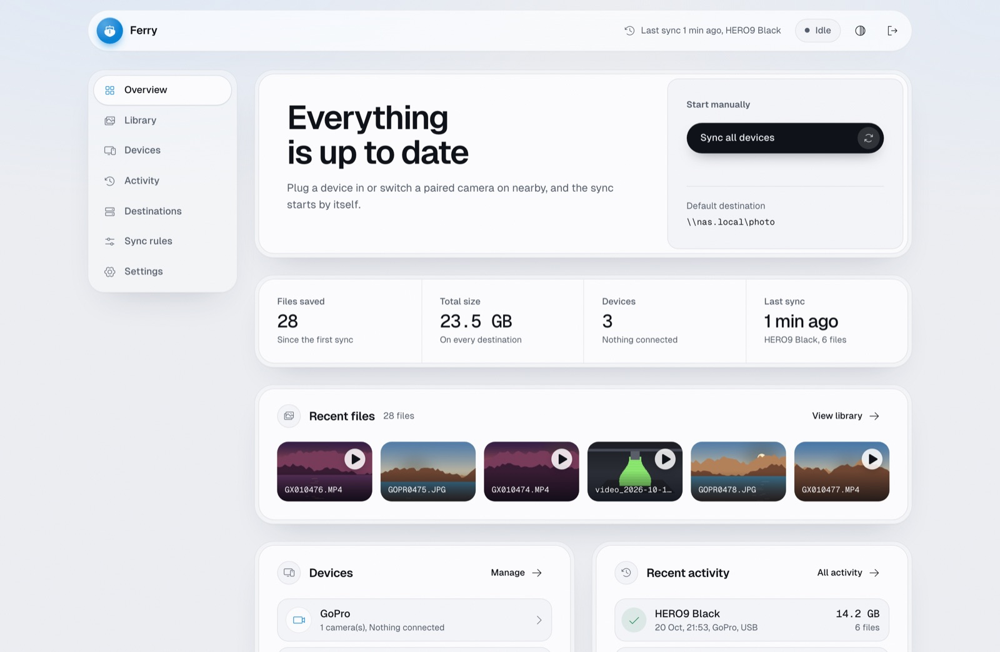
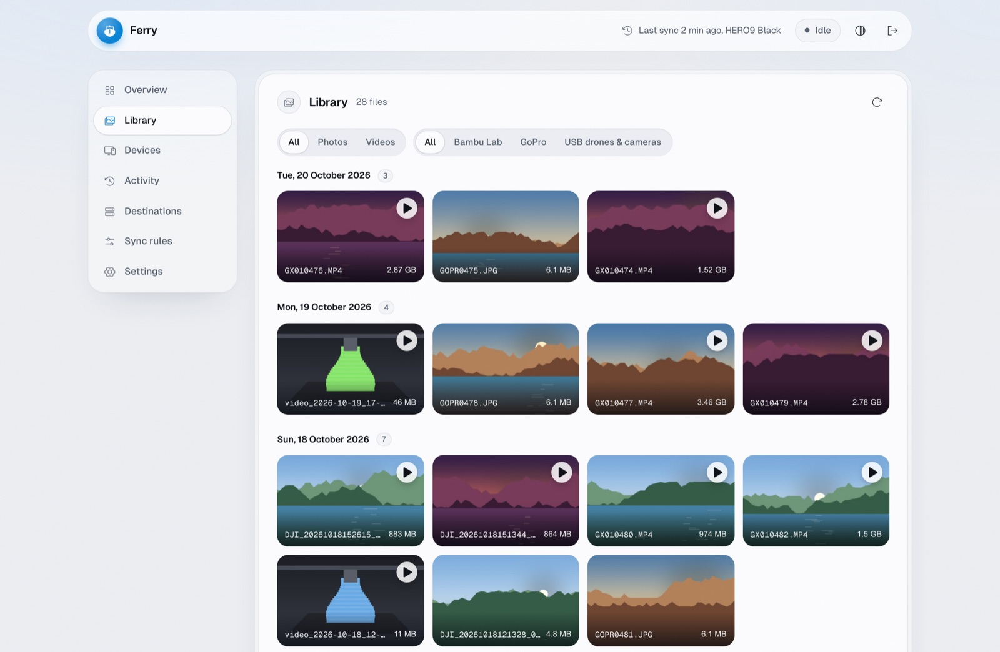
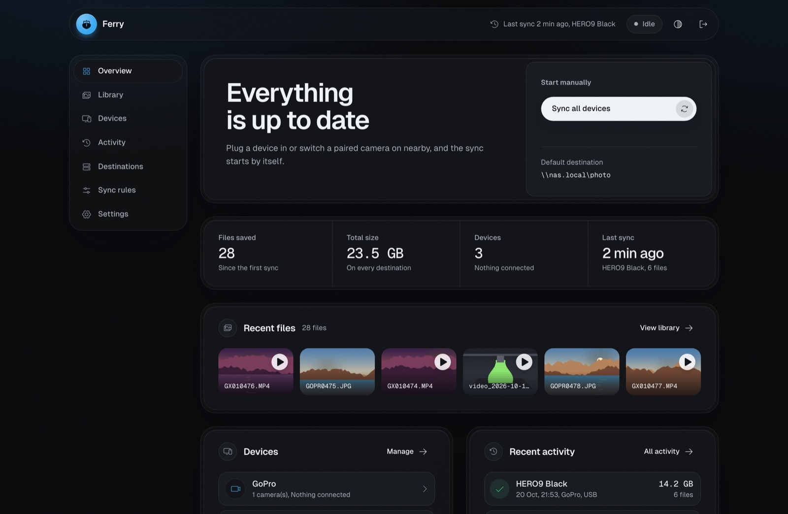
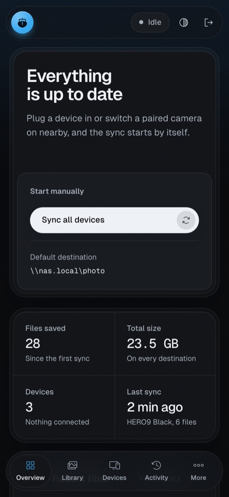

# Ferry

**Automatic offload for the devices that fill up with media.** Plug in a camera, drone or
SD card, or simply switch a paired GoPro on near the server. Ferry copies every new photo,
video and print timelapse to your NAS or cloud, checks that each file arrived intact, and can
then free up the device.

It runs as a single Docker container on a small Linux box, such as a Raspberry Pi, and you
manage it from a web UI on your phone or laptop.



## Why Ferry

- **Nothing to remember.** Devices sync when they show up: on USB, on Bluetooth, or when a
  print finishes. You no longer have to copy files by hand and wonder whether the card is
  safe to format.
- **Verified before anything is deleted.** A file only counts as saved once every destination
  holds it at the exact same size. Only then, and only if you turn it on, is it removed from
  the device.
- **One place for every device.** GoPro, DJI, Insta360, Bambu Lab printers and plain SD cards
  share the same destinations, rules and library.
- **Your storage, your layout.** SMB, SFTP, FTP, local disks, S3/R2 and Google Drive, with
  folder layouts you choose per device, such as `GoPro/HERO9 Black/2026/2026-10-20/`.
- **Resilient.** Interrupted transfers resume where they stopped. A file that keeps failing
  is skipped instead of blocking the rest. Nothing is copied twice.

## What it works with

| Sources | How |
| --- | --- |
| **GoPro** (HERO9 and newer) | USB, any number in parallel, or wireless: Bluetooth wakes the camera, Ferry joins its Wi-Fi and downloads |
| **DJI** (Neo and others), **Insta360**, any camera with a `DCIM` folder | USB mass storage, read-only |
| **Bambu Lab** printers (P1S, P1P, X1, A1) | Timelapses over the LAN (FTPS), a couple of minutes after each print |
| **SD cards** from any of the above | A USB card reader; each card is recognised as the device it came from |

| Destinations | Notes |
| --- | --- |
| **SMB** (Synology, QNAP, TrueNAS, Windows, Samba) | Servers and shares discovered from the UI |
| **SFTP** | Password or SSH key, host key pinned on first contact, server discovery |
| **FTP / FTPES / FTPS** | Certificate pinned, server discovery |
| **Local folder** | A disk on the host, with a folder picker |
| **S3-compatible** (Amazon S3, Cloudflare R2, Backblaze B2, MinIO, Wasabi) | Content-signed, multipart for large files |
| **Google Drive** | Its own folder, resumable uploads, MD5-checked |

Any destination can also be an **extra copy**, for example the NAS plus an R2 bucket off
site.

## A look around

| | |
| --- | --- |
|  |  |
| **Library**: everything synced, by day, filtered by type and device, with a built-in viewer that plays videos straight from the destination. | **Light and dark**: follows the system or your choice. |



The UI opens on an **Overview**: what is syncing right now and how fast, totals, the newest
files, device status and recent runs. Each area has its own page: **Library**, **Devices**,
**Destinations**, **Sync rules**, **Activity** (history and live log) and **Settings**. On a
phone the sidebar becomes a bottom tab bar.

The top bar always shows the current state. While a device syncs, it shows progress and
speed. When idle, it shows when the last sync ran and whether it worked.

<br clear="right">

## Quick start

You need a Linux host with Docker. A Raspberry Pi 4 or 5 is ideal. For wireless GoPro
offload you also need BlueZ (`sudo apt install bluez`).

```bash
git clone https://github.com/iacob28/Ferry.git && cd Ferry
docker compose -f docker-compose.yml -f docker-compose.dev.yml up -d --build
```

Open `http://<host>:8780`, create the admin password and add a destination. Then plug a
device in. Settings and state live in `./data`.

To run a prebuilt image instead, set `FERRY_IMAGE` (and `FERRY_TAG`) to wherever you publish
it, and use `docker compose up -d`. `scripts/release.sh` builds and pushes a multi-arch
(arm64 and amd64) image.

| Variable | Default | Purpose |
| --- | --- | --- |
| `FERRY_PORT` | `8780` | Web UI port |
| `FERRY_PASSWORD` | | Preset the admin password (otherwise set it in the browser) |
| `FERRY_DATA` | `./data` | Host folder for settings, state and staging |
| `FERRY_IMAGE` / `FERRY_TAG` | author's private registry / `latest` | Image to run with plain `docker compose up -d` |
| `TZ` | `UTC` | Time zone for logs and for cameras that do not store one |

**Wireless GoPro offload needs a Wi-Fi radio that is not the host's own network
connection.** Joining a camera's access point takes that radio off your LAN. Connect the host
over Ethernet and leave the built-in Wi-Fi for cameras, or add a USB Wi-Fi adapter. Ferry
refuses to use a radio that carries the default route.

### Behind Traefik

`docker-compose.traefik.yml` adds router labels for a Traefik instance on the same host. The
app uses host networking, so Traefik reaches it through the gateway of its Docker network:

```bash
FERRY_DOMAIN=ferry.example.lan TRAEFIK_UPSTREAM=http://172.19.0.1:8780 \
TRAEFIK_CERTRESOLVER=myresolver \
docker compose -f docker-compose.yml -f docker-compose.traefik.yml up -d
```

## Devices

### GoPro

- **USB:** plug the camera in and switch it on. Ferry finds it, syncs it, and puts it to
  standby when it is done.
- **Wireless:** on the camera open **Preferences > Connections > Connect Device > GoPro Quik
  App**, then in Ferry go to **Devices > Find cameras > Pair**. From then on, switching the
  camera on near the server starts a sync. After a successful sync the camera is left alone
  for a configurable pause.

Speeds are limited by the camera: about 10-15 MB/s on a HERO9, over Wi-Fi and USB alike.

### Drones and cameras over USB (DJI, Insta360)

Connect the device with a **data** USB cable (on the DJI Neo, USB-C) and switch it on.
Charge-only cables are common and the device then never appears. Ferry mounts it read-only,
looks for a `DCIM` folder and lists it under **Devices**.

The first time, choose **Adopt and sync**, or **Adopt** to set its folder and rules first.
After that it syncs whenever it is plugged in, and is unmounted when done, so you can unplug
it safely. Ferry never touches drives without `DCIM`, or file systems other than
FAT/exFAT/NTFS.

Capture dates come from the file name when the camera encodes them
(`DJI_20261020143012_...`), otherwise from the file time. Low-resolution proxies (`.LRF`,
`.LRV`) stay on the device; the list of file types is configurable.

The container needs `SYS_ADMIN`, the `b 8:* rmw` device rule and `/dev`, all set in
`docker-compose.yml`. If you would rather not grant those, let the host automount drives
(for example under `/media`), bind-mount that folder and add it as a *watch folder* in the
USB provider settings.

### SD cards

| Card from | Recognised by | Synced as |
| --- | --- | --- |
| GoPro | `DCIM/100GOPRO` and the serial in `MISC/version.txt` | That camera, with its rules and its "already synced" record, so nothing offloaded over USB or Wi-Fi is copied again |
| Bambu Lab printer | A `timelapse` folder | The printer (when one printer is set up) |
| DJI, Insta360, other cameras | The `DCIM` layout | A USB drive: adopt it once, with its own rules |

The host's built-in SD slot is off by default, since a Raspberry Pi may boot from it. To use
it, add the `b 179:* rmw` device rule in `docker-compose.yml` and switch on *Built-in SD
slot* in the USB provider settings.

### Bambu Lab printers

1. Under **Devices**, choose **Add printer**.
2. Choose *Find printers on the network*. This fills in the IP address and serial number
   from the printer's own announcements.
3. Enter the **LAN access code** from the printer screen (Settings, Network).

Ferry checks the code over FTPS, pins the printer's certificate, and follows the print state
over the printer's local MQTT (read only). It copies new timelapses a couple of minutes after
a print ends, and on a timer while the printer is idle, never while a print is running. Turn
on timelapse recording in Bambu Studio for the prints you want.

## Destinations and sync rules

Destinations and credentials are set up once and shared. Sync rules come in layers, and each
layer only overrides what it sets:

1. **Global rules:** destination, folder, folder layout, extra copies and delete after sync.
2. **Provider settings** (GoPro, USB drones & cameras, Bambu Lab): overrides for every device
   of that kind, plus the provider's own options, such as automatic sync, standby and the
   wireless pause.
3. **Device settings:** overrides for one device, such as its own folder or a different login.

Every field shows the value it inherits until you switch on *Override*, and a live preview
shows exactly where a file will land.

### How files are organised

A file lands at `<folder>/<layout>/<file name>`. These fields are available in both the
folder and the layout:

```
{year} {month} {day} {date} {provider} {device} {model}
```

For example, folder `{provider}/{device}` and layout `{year}/{date}` give
`GoPro/HERO9 Black/2026/2026-10-20/GX010474.MP4`.

Dates come from the camera's clock. Cameras reuse file numbers after a card format; if a
*different* file with the same name already exists, the new one is saved as
`GX010474_<timestamp>.MP4`. A file already present at the same size is not uploaded again,
so several servers can share one destination.

### Deleting from the device

Delete after sync is off by default. When enabled, a file is deleted only after every
destination holds it at the exact same size. This also covers files synced before you turned
the option on: before deleting them, Ferry checks that each is still on the destination.

### When something goes wrong

- **Interrupted transfers resume** from where they stopped, on the device side (HTTP ranges,
  FTP `REST`) and through the local staging folder.
- **A file that fails after its retries is skipped.** The rest of the run carries on, and the
  run history says which file was left on the device.
- **A file that fails in three runs is no longer tried.** One corrupt file therefore never
  blocks a device. Two files failing back to back still stop the run, because that usually
  means the connection dropped.

### SFTP and FTP details

- **SFTP:** host, port (22), folder on the server (absolute with a leading `/`, otherwise in
  the user's home), and a username with a password or an SSH key (OpenSSH Ed25519, ECDSA or
  RSA).
- **FTP:** FTPES (AUTH TLS on port 21, the default), FTPS (implicit TLS on 990) or plain FTP
  (password in the clear: trusted LAN only). Data channels reuse the control channel's TLS
  session, as vsftpd and most NAS servers require.
- **Pinning:** the host key or certificate is pinned on the first test or sync. If the server
  later presents another one, Ferry refuses to connect until you clear the pin.
- **Discover** lists servers answering on 22, 21 or 990 (and those announced over mDNS), and
  fills in the port and TLS mode.
- **Uploads** go to `<name>.partial` and are renamed when complete, so a half-written file
  is never taken for a finished one.

### Cloud destinations

- **S3 / R2:** endpoint (`https://<account id>.r2.cloudflarestorage.com` for R2, empty for
  Amazon S3), bucket, optional prefix and an access key.
  - Every request is signed over its content's SHA-256.
  - Files over 16 MB go up as multipart uploads, which only appear once complete.
  - The library streams straight from the bucket.
- **Google Drive:**
  1. In Google Cloud Console, enable the Drive API and create an OAuth client of type *TVs
     and Limited Input devices*.
  2. Add the client under **Credentials > Google account**.
  3. Press *Connect* and enter the code Ferry shows at google.com/device.

  Ferry uses the `drive.file` scope, so it only sees what it created, starting with its own
  folder in My Drive.

## Architecture

```
ferry/
├── core/          the offload engine: download to staging, upload, verify, optional delete;
│                  sessions, layered settings, SQLite bookkeeping
├── providers/     one package per device family; each watches for its devices and opens
│                  them as a MediaSource (list_media, download, delete, thumbnail)
├── destinations/  where media goes (stat, atomic put, open_range); keys are relative
│                  POSIX paths, so NAS shares, object stores and Drive share one contract
└── static/        the web UI: one HTML file, no build step
```

The core only knows the two contracts, so adding a device family or a storage backend does
not touch the engine.

## Development

```bash
uv venv && uv pip install -e ".[dev,media]"
.venv/bin/pytest
FERRY_DATA=./.dev-data .venv/bin/python -m ferry   # http://localhost:8780
docker compose -f docker-compose.yml -f docker-compose.dev.yml up -d --build
scripts/release.sh   # multi-arch build and push (IMAGE=... to override)
```

On macOS the app runs natively for USB offload and UI work. Docker Desktop cannot reach USB
network devices or Bluetooth, so the container is meant for Linux hosts.

### Upgrading from GoPro Sync

Ferry was called GoPro Sync until 0.2.0, and its data folder is compatible: point
`FERRY_DATA` at the old one and nothing is synced twice. The old `GOPRO_SYNC_*` variables are
still read when the `FERRY_*` ones are not set.

## Credits

Bundled assets: [Geist](https://vercel.com/font) (SIL Open Font License) and
[Phosphor Icons](https://phosphoricons.com) (MIT), see `ferry/static/vendor`. The library
images in the screenshots are generated demo artwork.

GoPro, DJI, Insta360 and Bambu Lab are trademarks of their owners. Ferry is not affiliated
with any of them.
